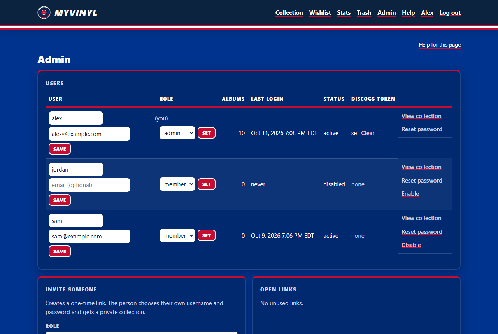

## Administering the site

This part is shown only to admins.

Admins see an **Admin** link in the menu. Admins can see and change every collection,
so give the role only to people you'd trust with everything.

### Managing users

*Admin: users, invites, and backups.*

| Task | How |
|---|---|
| Invite someone | **Admin** → **Invite someone** → choose **member** or **admin** → **Create invite link** → send the link privately. It is shown only once. |
| Make someone an admin (or demote) | **Users** table → role menu → **Set**. |
| Rename a user or set their email | **Users** table → edit the username and email boxes → **Save**. They log in with the new username from then on. |
| Reset a password | **Reset password** on their row → send the one-time link. Using it signs them out everywhere. |
| Disable an account | **Disable** on their row. They're signed out at once and can't log in; their data is kept. **Enable** restores access. |
| Cancel an unused link | **Open links** → **Revoke**. |
| Work in someone's collection | **View collection** on their row. A red banner shows whose collection you're in; anything you add or import goes there. **Back to mine** to leave. Discogs sync isn't available while viewing someone else's collection: it only ever reads the signed-in user's own Discogs account. |

Notes:
- You can't disable yourself, and the last active admin can't be disabled or demoted.
- Accounts can't be deleted (so no data is lost by accident); disable them instead.
- Usernames and emails are unique, ignoring letter case.

### Backups
- myvinyl backs up the database every 24 hours and keeps the last 14.
- **Admin** → **Back up now** makes one immediately; the list shows the latest files.

### Users' Discogs tokens
Each user adds their own token on their Profile page. The **Users** table shows
**set** or **none** per user; **Clear** removes a user's token (for example if it leaked).
Admins can never see a token.
