myvinyl keeps an inventory of your vinyl records, with values, art, and details looked
up on Discogs. Each section below covers one part of the site; the **Help** links on
the pages bring you to the matching section.

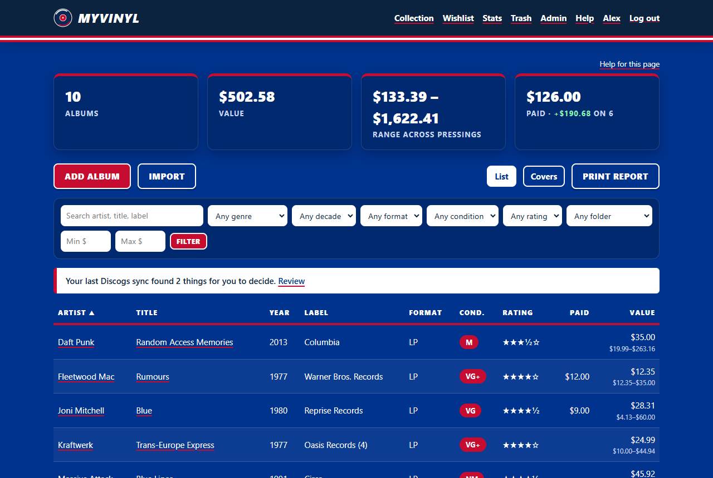
*Your collection, with the filter bar and the List / Covers switch.*

## Getting started
1. Open the invite link the admin sent you. It works once and expires after 7 days.
2. Choose a username (3 to 32 letters, digits, `.`, `-`, or `_`), an optional email
   address, and a password of at least 12 characters.
3. You're signed in to your own private collection. Nobody but you and the admins can see it.

## Adding albums
| Method | How |
|---|---|
| By barcode or catalog number (most exact) | **Add album** → type it in the top box → set the condition → **Save**. If several pressings match, pick yours. |
| By artist and title | **Add album** → artist, title, format, condition → **Save**. |
| Your own Discogs collection (best) | Add your Discogs token first (see [Your Discogs collection](#your-discogs-collection)), then **Import** → **Sync my Discogs collection**. Private folders, grades, and notes come too. |
| Someone's public Discogs collection | **Import** → **Import someone's public collection** → their Discogs username → default condition → **Import collection**. |

- Leave **Street value** blank and myvinyl looks it up on Discogs. A lookup takes about
  12 to 30 seconds, and the album page refreshes itself until it's done.
- Fields you fill in are never overwritten. Blank label and year are filled from Discogs.
- Wrong barcode, or added without one? **Edit** → change **Barcode or catalog number**
  → **Save**. The pressing is looked up again, just as on Add.

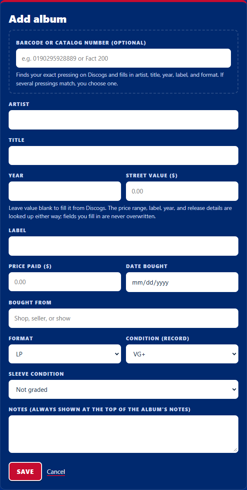
*Add album. A barcode or catalog number gives the most exact match.*

## Your Discogs collection
With your own Discogs token, myvinyl reads your Discogs collection, including private
folders, and keeps it in step. It only reads from Discogs; it never changes anything there.

1. **Add your token:** on Discogs, Settings → Developers → **Generate new token**. In
   myvinyl, your name (top right) → **Discogs token** → paste it, enter your password,
   **Save token**. myvinyl shows which Discogs account it belongs to.
2. **Sync:** **Import** → choose a condition for copies that have no grade on Discogs →
   **Sync my Discogs collection**. The page shows progress and refreshes itself.
3. **What comes across:** every copy in every folder (two copies of a record become two
   albums), its folder, Discogs' **Media Condition** and **Sleeve Condition**, the
   **Notes** field, your star rating, and the date you added it. Only vinyl is imported.
4. **Prices:** each new album gets a quick price for your exact pressing right away. The
   range across other pressings fills in automatically over the next few hours.
5. **Sync again** any time to pick up changes. The rules:
   - Discogs decides which copies you have, their folders, and dates added.
   - myvinyl decides grades, notes, and ratings. A change made on Discogs is copied here
     only if you haven't changed that field here since the last sync.
   - Changed in both places? It goes on the **Discogs sync** page for you to choose
     **Keep mine** or **Use Discogs** (or the same for all at once).
   - Gone from Discogs? Listed on the same page: **Move to trash** or **Keep it here**.
     Nothing is removed without you.
   - Albums you already had here for the same pressing are matched, not duplicated.
   - Something you put in the trash here isn't brought back by a sync.
6. **If a sync stops** (network trouble, or the server restarted), **Resume sync** on the
   Import page continues where it left off.

A notice on your collection page tells you when a sync found something to decide. The
**Discogs sync** page (link on the Import page) also lists recent activity. Filter your
collection by **Discogs folder** with the folder menu in the filter bar.

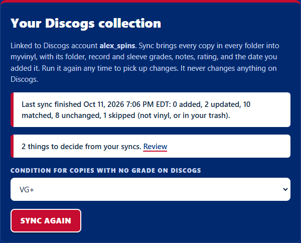
*Import: sync your Discogs collection and see the result of the last sync.*

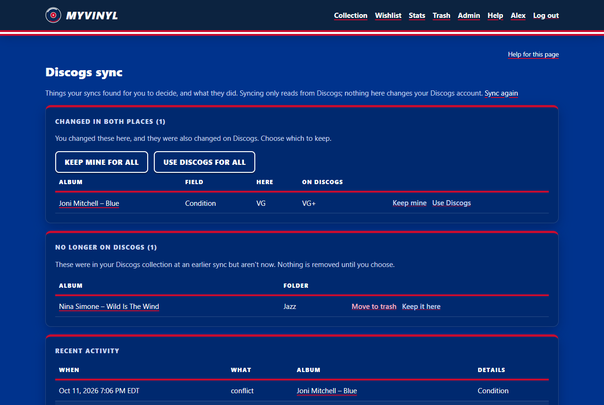
*The Discogs sync page: things to decide, and recent activity.*

## The album page
| Section | What you can do |
|---|---|
| Street value / Range | The lowest Discogs asking price for your pressing, plus the low-high range across up to 10 pressings. Not an appraisal. |
| Pressings checked | If the matched pressing isn't yours, click **Mine** on the right row. Value, details, and art switch to it. |
| Refresh from Discogs | Re-check prices now. Prices also refresh automatically about once a week. |
| Value history | A chart of value and range over time; it appears after two lookups. |
| Your rating and review | Half a star to 5 stars, plus a written review. |
| Rate tracks | Link above the tracklist: a rating and short note per track. |
| Album art | Click an image to make it the displayed cover, or **Use your own image** to upload one (JPEG, PNG, WebP, or GIF, up to 5 MB). Your upload stays until you remove it or click a Discogs image. |
| Notes | Add dated notes: cleanings, plays, where you found it. |
| Purchase | **Edit** → price paid, date, where bought. Gain or loss is calculated for you. |
| Record and sleeve grades | **Edit** → **Condition (record)** and **Sleeve condition** (Goldmine grades; a sleeve can also be Generic or No cover, or left Not graded). |
| Discogs chips | Folder name and "in your Discogs collection" show for albums linked to your Discogs collection. |

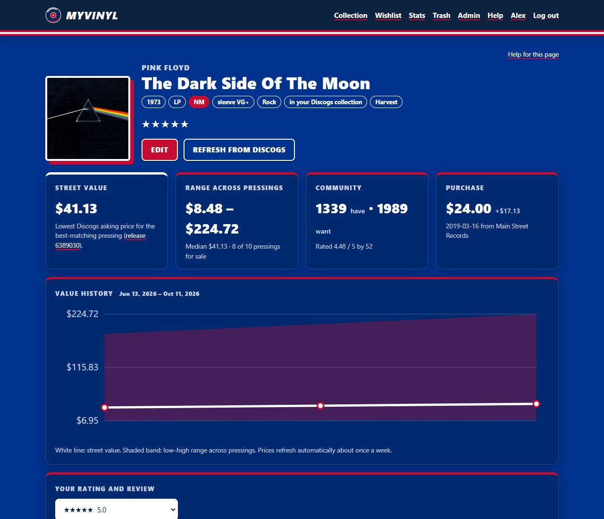
*An album page: value and range, grades, purchase, rating, and value history.*

## Finding and reporting
- **Filter bar** (collection and Stats pages): search text, genre, decade, format,
  condition, minimum rating, Discogs folder (after a sync), value range. **Clear** resets it.
- **List / Covers** switches between the table and a cover grid. Click a column header to sort.
- **Stats:** breakdowns by genre, decade, format, condition, label, and rating.
- **Print report:** a printable list of the current (filtered) view. Use your browser's
  Print (Ctrl+P or Cmd+P); choose "Save as PDF" for a file.
- **Export CSV:** a spreadsheet of the current view.

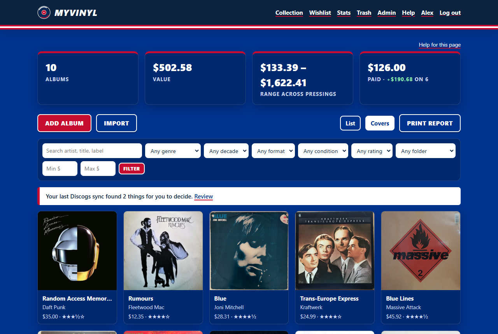
*Covers view.*

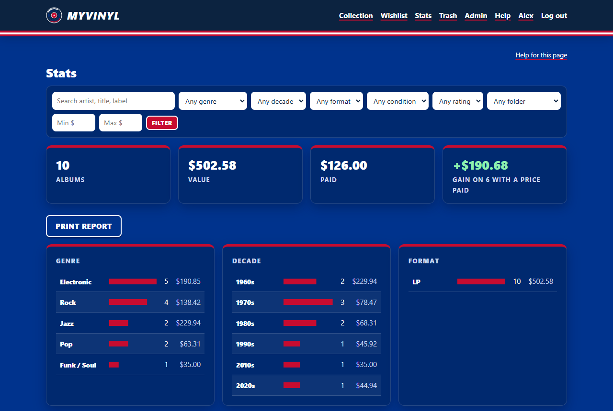
*Stats for the whole collection or the current filter.*

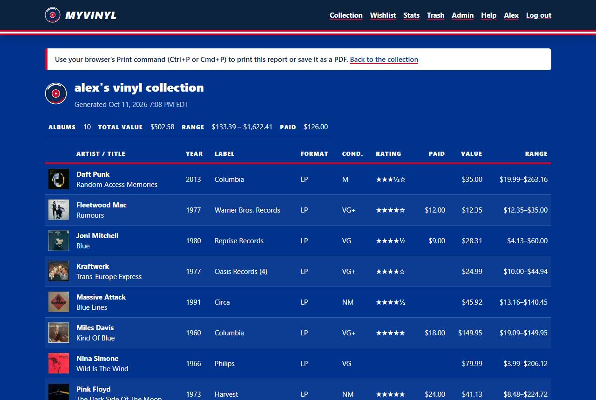
*Print report.*

## Wishlist
- **Wishlist** → add artist, title, and an optional target price. myvinyl checks the
  lowest Discogs price weekly and highlights records at or below your target.
- **Import wantlist** pulls in your public Discogs wantlist.
- **Got it:** choose the condition, enter what you paid, and the record moves to your collection.

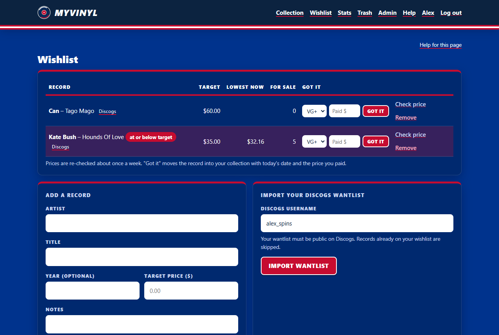
*Wishlist with target prices.*

## Deleting and restoring
- **Edit** → **Move this album to the trash**.
- **Trash** → **Restore** puts it back; **Delete forever** removes it. Albums left in the
  trash are deleted automatically after 30 days.

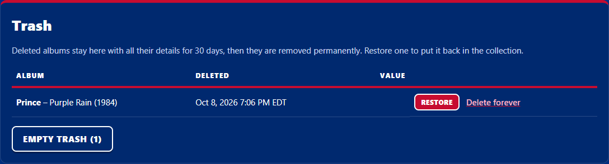
*Trash.*

## Your profile
Click your name (top right):
- **Display name, About, Discogs username** (pre-fills the import forms).
- **Discogs token:** add, replace, or remove your own token (needs your password). It
  links your Discogs account for syncing and speeds up lookups. Only its last 4
  characters are shown, and admins can't see it.
- **Username and email:** change either one; this needs your current password. Your
  albums and settings stay the same. Email is optional and not used yet (it's kept for
  future email notices and password resets).
- **Theme:** Royal blue, Navy, Light, Gray, or Automatic (follows your device's dark mode).
- **Change password**, which signs out your other sessions.
- **Sign out everywhere**, if you used a shared or lost device.

Forgot your password? Ask an admin for a reset link.

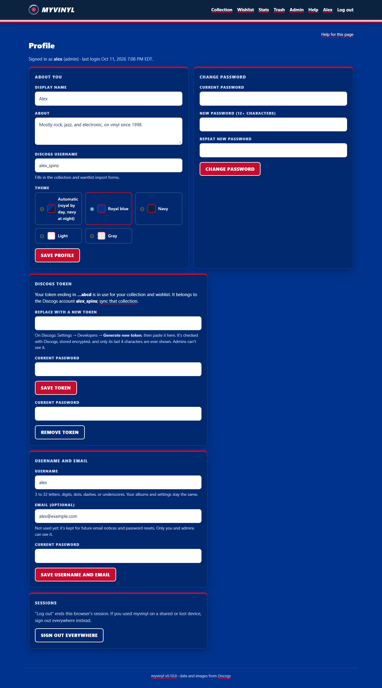
*Profile, including your Discogs token.*
